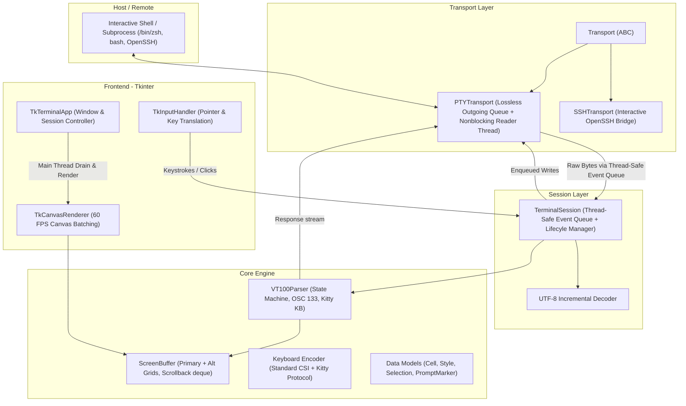

# Clownfish Architecture

Clownfish is a modular terminal emulator written in Python. This document describes the internal subsystems, data flow, concurrency model, and session architecture.

---

## Subsystems

### 1. Core Engine (`clownfish.core`)
- **`models.py`**:
  - `Style`: 24-bit RGB TrueColor fg/bg tuples, plus attributes (`bold`, `italic`, `underline`, `reverse`).
  - `Cell`: Individual grid cell (`char`, `style`, `url`, `width`). Supports East Asian Wide characters (width=2) with continuation spacers (width=0).
  - `Selection`: Normalized character cell coordinates for active mouse selection.
  - `PromptMarker`: Semantic prompt tracking for OSC 133 shell integration.
- **`keyboard.py`**:
  - Keystroke translation to standard ANSI/xterm sequences and Kitty keyboard protocol (`CSI u` and modified cursor navigation).
- **`screen.py`**:
  - `ScreenBuffer`: Dual-grid architecture (`primary_grid` and `alt_grid`), pending autowrap delay (`wrap_pending`), dirty row tracking, prompt marker preservation, and high-performance scrollback (`collections.deque`).
- **`parser.py`**:
  - `VT100Parser`: Fast state machine parser handling ANSI colors, colon-delimited SGR subparameters, OSC 8 hyperlinks, OSC 133 shell integration, device attributes (DA1, DA2, DSR, color queries), and bounded payloads with robust ST (`ESC \`) termination detection.

### 2. Session Layer (`clownfish.session`)
- **`TerminalSession`**:
  - Owns `ScreenBuffer`, `VT100Parser`, input encoding, and `Transport`.
  - Independent of any GUI or platform: can be run headless, in test environments, in background automations, or attached to desktop frontends.
  - Thread-Safe Event Queue: Background transport threads deliver incoming byte chunks and disconnect notifications into a safe `queue.Queue`. The UI event loop drains these on the main thread, guaranteeing that screen buffer mutations and widget operations are strictly thread-safe.
  - Default Transport Factory: Decoupled via `set_default_transport_factory` / `get_default_transport` so embedded and non-POSIX environments can load sessions without requiring desktop POSIX PTY modules.

### 3. Transport Layer (`clownfish.transports`)
- **`Transport` (ABC)**:
  - Base interface defining `start()`, `write()`, `resize()`, `close()`, `is_alive()`, and callback registration.
- **`PTYTransport`**:
  - Local pseudo-terminal transport using `pty.fork()` and `termios.TIOCSWINSZ`.
  - Lossless outgoing write queue: Asynchronously drains unwritten bytes when the PTY file descriptor becomes writable without blocking caller threads or dropping bytes on `EAGAIN`.
  - Background reader thread multiplexes incoming PTY reads and outgoing write queue flushes via `select.select()`.
- **`SSHTransport`**:
  - Interactive OpenSSH client transport allocating a remote pseudo-terminal (`ssh -tt`).

### 4. Desktop Frontend (`clownfish.frontends.tkinter`)
- **`TkCanvasRenderer`**: Canvas rendering pipeline with font metrics, dirty row caching, contiguous cell span batching, and selection highlighting.
- **`TkInputHandler`**: Translates mouse selection (single, double word, triple line), hyperlink clicks, mouse wheel scrolling, and keyboard events into session actions.
- **`TkTerminalApp`**: Main Tkinter window coordinating session lifecycle, window resizing, shortcuts (`Cmd+K`, `Cmd+C`, `Cmd+V`, `Cmd+Up/Down`), and main thread event draining.
