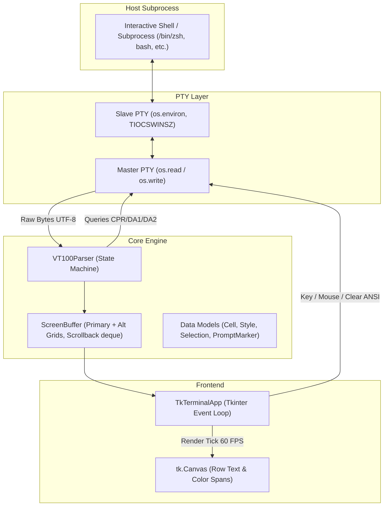

# Clownfish Architecture

Clownfish is a modular terminal emulator written in Python and Tkinter. This document describes the internal subsystems, data flow, and concurrency model.

---

## Subsystems

### 1. Data Models (`clownfish.models`)
- **`Style`**: Stores TrueColor 24-bit RGB tuples for foreground and background, plus text attributes (`bold`, `italic`, `underline`, `reverse`).
- **`Cell`**: Individual grid cell containing `char: str`, `style: Style`, `url: str | None` (OSC 8 hyperlink), and `width: int` (1 for normal, 2 for wide glyph leader, 0 for wide continuation spacer).
- **`Selection`**: Coordinates of active visual selection, normalized across row and column bounds.
- **`PromptMarker`**: Semantic prompt boundary tracking line numbers, commands, and exit codes for OSC 133 shell integration.
- **`char_width(char)`**: Utility utilizing `unicodedata.east_asian_width` and Unicode combining marks to identify 0, 1, or 2 column widths.

### 2. Screen Buffer (`clownfish.screen`)
- **Primary & Alt Grids**: Two 2D grids of `Cell` objects (`primary_grid` and `alt_grid`). Interactive CLI programs (e.g. `vim`, `htop`, `less`) toggle alt-screen mode (`CSI ? 1049 h / l`).
- **Scrollback History**: High-performance `collections.deque(maxlen=10_000)` storing displaced lines as the cursor scrolls downward.
- **Scroll Regions**: Support for top/bottom scrolling margins (`CSI r`) used in split-pane text editors.
- **Dirty Line Tracking**: Set of modified row indices to minimize redundant canvas redraw calls during high-throughput output.
- **`clear_all()`**: Purges the scrollback history, resets scroll offset to 0, blanks the active grid, homes the cursor, and marks all rows dirty.

### 3. Escape Sequence Parser (`clownfish.parser`)
- **State Machine**: Ground -> Escape -> CSI -> OSC transitions.
- **CSI Processor**: Dispatches cursor movement, text insertion/deletion, erasing, scrolling regions, SGR color handling (16-color, 256-color palette, and 24-bit TrueColor), and mouse tracking modes (`?1000h`, `?1006h`).
- **Protocol Identification & Queries**:
  - Responds to DA1 (`CSI c`) with VT220 status `\x1b[?62;c`.
  - Responds to DA2 (`CSI >c`) with VT220/xterm status `\x1b[>1;10;0c`.
  - Responds to DSR (`CSI 6n`) with cursor position `\x1b[{row};{col}R`.
  - Responds to OSC 10/11 color queries with configured theme RGB values.
- **Kitty Keyboard Protocol**: Handles queries (`CSI ? u`), flag settings (`CSI = u`), stack pushing (`CSI > u`), and stack popping (`CSI < u`).
- **OSC 133 Shell Integration**: Dispatches semantic prompt markers (`A`, `B`, `C`, `D`).

### 4. Application Frontend (`clownfish.app`)
- **PTY Management**: Forks child process with `pty.fork()`, configures `TERM=xterm-256color` and `COLORTERM=truecolor`, and binds non-blocking I/O to Tk's file event handler (`tk.createfilehandler`).
- **Window Resizing**: Listens to `<Configure>` events, debounces resize calculations, resizes the screen buffer, and propagates window geometry to the kernel via `ioctl(TIOCSWINSZ)`.
- **Render Pipeline**: A 60 FPS tick (`root.after(16, self._render_tick)`) redraws dirty rows, batches identical-styled adjacent single-width cells into contiguous canvas strings, and draws selection overlays.
- **Keyboard & Mouse Dispatch**: Handles full clipboard integration (copy on selection, bracketed paste mode), mouse tracking (SGR decimal format), and keyboard shortcut translation.
