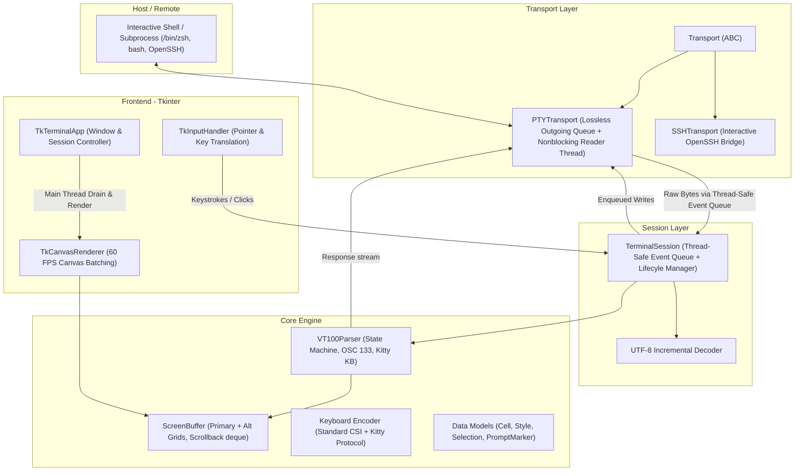

# Clownfish Architecture

Clownfish is a modular terminal emulator written in Python. This document describes the internal subsystems, data flow, concurrency model, and session architecture.

---

## Subsystems

### 1. Core Engine (`clownfish.core`)
- **`models.py`**:
  - `Style`: 24-bit RGB TrueColor fg/bg tuples, plus attributes (`bold`, `italic`, `underline`, `reverse`).
  - `Cell`: Individual grid cell (`char`, `style`, `url`, `width`). Supports East Asian Wide characters (width=2) with continuation spacers (width=0).
  - `Selection`: Normalized character cell coordinates for active mouse selection.
  - `PromptMarker`: Semantic prompt tracking for OSC 133 shell integration.
- **`keyboard.py`**:
  - Keystroke translation to standard ANSI/xterm sequences and Kitty keyboard protocol (`CSI u` and modified cursor navigation).
- **`screen.py`**:
  - `ScreenBuffer`: Dual-grid architecture (`primary_grid` and `alt_grid`), pending autowrap delay (`wrap_pending`), dirty row tracking, prompt marker preservation, and high-performance scrollback (`collections.deque`).
- **`parser.py`**:
  - `VT100Parser`: Fast state machine parser handling ANSI colors, colon-delimited SGR subparameters, OSC 8 hyperlinks, OSC 133 shell integration, device attributes (DA1, DA2, DSR, color queries), and bounded payloads with robust ST (`ESC \`) termination detection.

### 2. Session Layer (`clownfish.session`)
- **`TerminalSession`**:
  - Owns `ScreenBuffer`, `VT100Parser`, input encoding, and `Transport`.
  - Independent of any GUI or platform: can be run headless, in test environments, in background automations, or attached to desktop frontends.
  - Thread-Safe Event Queue: Background transport threads deliver incoming byte chunks and disconnect notifications into a safe `queue.Queue`. The UI event loop drains these on the main thread, guaranteeing that screen buffer mutations and widget operations are strictly thread-safe.
  - Default Transport Factory: Decoupled via `set_default_transport_factory` / `get_default_transport` so embedded and non-POSIX environments can load sessions without requiring desktop POSIX PTY modules.

### 3. Transport Layer (`clownfish.transports`)
- **`Transport` (ABC)**:
  - Base interface defining `start()`, `write()`, `resize()`, `close()`, `is_alive()`, and callback registration.
- **`PTYTransport`**:
  - Local pseudo-terminal transport using `pty.fork()` and `termios.TIOCSWINSZ`.
  - Lossless outgoing write queue: Asynchronously drains unwritten bytes when the PTY file descriptor becomes writable without blocking caller threads or dropping bytes on `EAGAIN`.
  - Background reader thread multiplexes incoming PTY reads and outgoing write queue flushes via `select.select()`.
- **`SSHTransport`**:
  - Interactive OpenSSH client transport allocating a remote pseudo-terminal (`ssh -tt`).

### 4. Desktop Frontend (`clownfish.frontends.tkinter`)
- **`TkTerminalApp`**: Root application controller coordinating multi-tab views, window resizing, global shortcuts (`Cmd+T`, `Cmd+W`, `Cmd+K`, `Cmd+D`, etc.), active job close confirmations, and safe multiline paste prompts.
- **`TabbedTerminalView`**: Manages independent terminal tabs with a custom tab bar, tab switching, and working-directory inheritance.
- **`SplitView`**: Manages arbitrary nested horizontal and vertical panes with resizable sash dividers, split cycling (`Cmd+[` / `Cmd+]` or `Alt+[` / `Alt+]`), split equalization (`Cmd+=` / `Ctrl+=`), and active pane border highlights (`#4a90e2`).
- **`TerminalPane`**: Embeds a `TerminalSession`, `TkCanvasRenderer`, `TkInputHandler`, and search overlay bar. Features adaptive render ticks (1ms bursts, 16ms interactive, 100ms idle/hidden tabs) and DECSET 1004 focus reporting.
- **`TkCanvasRenderer`**: Canvas rendering pipeline with font metrics, dirty row caching, contiguous cell span batching, and z-ordered selection/search highlighting behind legible text.
- **`TkInputHandler`**: Translates mouse selection (single, double word, triple line), hyperlink clicks, mouse wheel scrolling, and keyboard events into session actions.

---

## Security & Protocol Conformance

- **OSC 52 Clipboard Isolation**: Reading the host clipboard via OSC 52 query is disabled by default (`allow_clipboard_read = False`) to protect sensitive user credentials from unauthorized remote reads (e.g. over SSH). Writing to clipboard remains permitted by default and configurable (`allow_clipboard_write`).
- **OSC 7 Working Directory Validation**: OSC 7 URI hostnames are strictly validated against local hostnames (`localhost`, `127.0.0.1`, local nodename), and directory paths must exist locally before being accepted. Invalid or remote directories automatically fall back to the user's home directory.
- **Defensive Parser Bounds**: CSI parameters are bounded to 32 digits, 64 parameter groups, and 16 subparameters. OSC and DCS strings are bounded to 8,192 bytes to defend against memory exhaustion and integer conversion denial-of-service.
- **PTY Backpressure & Packaging Trampoline**: Both incoming event queues (4,096 items) and outgoing write queues (1,000 chunks) have bounded limits. The PTY launcher includes a `--pty-trampoline` entrypoint compatible with PyInstaller-frozen `.app` bundles where `sys.executable` is not a Python interpreter.
- **Job Control & Safe Teardown**: Active foreground jobs are detected via `os.tcgetpgrp(master_fd)` to prompt for user confirmation before terminating running processes during tab or window close. Safe multiline paste protects against accidental execution of newline-separated shell commands.
